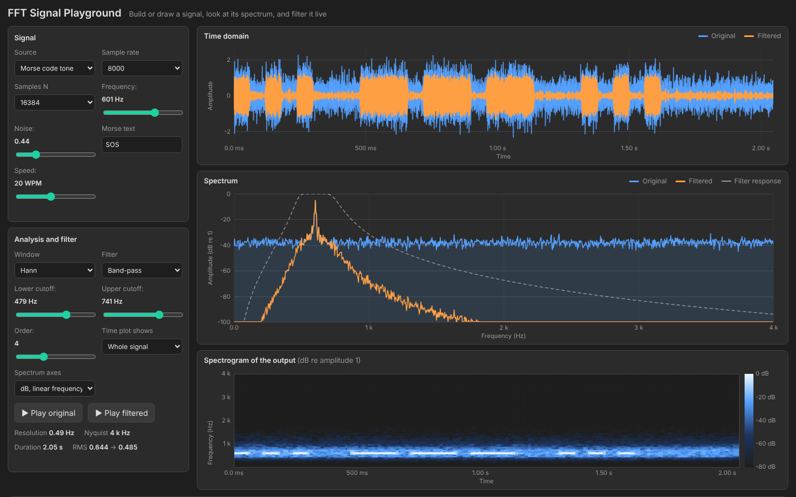

# FFT Signal Playground

An interactive tool for learning how the Fourier transform behaves in practice.
Type an expression, pick a built-in signal, or draw a waveform with the mouse
and see its spectrum, filter it live, and watch a spectrogram of the result.
A Python backend (NumPy) does the signal processing; the browser frontend plots
and plays it.



The screenshot shows Morse code ("SOS" keyed on a 600 Hz tone) buried in noise.
A band-pass filter around 600 Hz recovers it: the orange trace is the filtered
signal, and the spectrogram shows each dot and dash.

## What you can do

- **Make a signal:** sine, two tones, square, triangle, sawtooth, chirp, AM,
  Morse code, a typed expression such as `sin(2*pi*200*t) + 0.5*sin(2*pi*1300*t)`,
  or a waveform drawn with the mouse
- **See aliasing:** push a tone above the Nyquist frequency and watch it fold
  back to a lower frequency
- **Compare windows:** rectangular, Hann, Hamming and Blackman, with amplitudes
  calibrated so a sine of amplitude $A$ always reads $A$
- **Filter live:** low-pass, high-pass, band-pass and band-stop (notch),
  orders 1 to 10, with the filter response drawn over the spectrum
- **Listen:** play the original or filtered signal through the browser
- **Read exact numbers:** hover either plot for a readout, and see the strongest
  peaks in a table with their interpolated frequencies

## The maths

For $N$ samples at sample rate $f_s$ the DFT is

$$
X[k] = \sum_{n=0}^{N-1} x[n]\,e^{-j 2\pi k n / N}
\qquad
f_k = k\,\Delta f
\qquad
\Delta f = \frac{f_s}{N}
$$

The amplitude spectrum divides out the window's coherent gain $\mathrm{CG}$ so
that levels are comparable between windows:

$$
A_k = \frac{2\,|X_w[k]|}{N \cdot \mathrm{CG}}
\qquad
\mathrm{CG} = \frac{1}{N}\sum_{n} w[n]
$$

A tone above $f_s/2$ aliases to

$$
f_{\mathrm{alias}} = \left| f - f_s\,\mathrm{round}(f/f_s) \right|
$$

Filters use a Butterworth magnitude response, for example for a low-pass of
order $n$ and cutoff $f_c$

$$
|H(f)| = \frac{1}{\sqrt{1 + (f/f_c)^{2n}}}
$$

applied in the frequency domain, which gives zero phase shift. The full set of
formulas (windows, scalloping loss, peak interpolation, band filters, the
spectrogram and a worked example) is in
[docs/FFT_Formulas.pdf](docs/FFT_Formulas.pdf).

## Project structure

```
.
├── signals.py         # DSP core: generators, windows, FFT, filters, spectrogram
├── server.py          # Flask backend: HTTP API
├── launch.pyw         # double-click launcher (no console window)
├── requirements.txt
├── static/
│   └── index.html     # frontend: plots, controls, audio playback
├── docs/
│   ├── FFT_Formulas.pdf
│   └── FFT_Formulas.tex
├── tests/
│   └── test_signals.py
└── assets/
    └── screenshot.png
```

## Setup

```bash
pip install -r requirements.txt
```

## Usage

```bash
python server.py
```

This starts a local server and opens `http://127.0.0.1:8003` in your browser
automatically. Closing the browser tab shuts the server down on its own. On
Windows, `launch.pyw` does the same without opening a console window.

### Tips

- Set the sample rate to 1000 Hz and a sine to about 900 Hz to see aliasing.
- Compare **Rectangular** and **Blackman** on a tone that falls between two bins
  to see leakage and the dynamic range of each window.
- Use **Morse code tone** with noise added, then a band-pass filter, to see why
  filtering helps and what the spectrogram shows.
- In **Draw** mode, click **Start from current signal** to edit an existing
  waveform instead of starting from silence.

### API

| Endpoint | Method | Purpose |
| --- | --- | --- |
| `/api/preset` | GET | generate a built-in signal: `name` `fs` `n` `freq` `noise` `text` `wpm` |
| `/api/analyze` | POST | `{"x": [...], "fs": 8000, "window": "hann", "filter": {...}}` returns the filtered signal, spectra, response, peaks and spectrogram |

The `filter` object is `{"type": "lowpass", "fc": 900, "order": 4}`. Band
filters also take `fc2`.

### Tests

```bash
python -m pytest tests
```

The tests check amplitude calibration for every window, peak interpolation,
the $-3$ dB point of each filter, aliasing, input validation and that an empty
output reads as silent.

## License

MIT, see [LICENSE](LICENSE).
